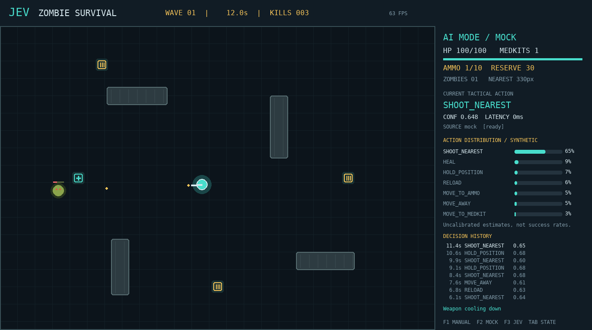

# Jev Zombie Survival

Game **Python 3.11+ / Pygame**, góc nhìn từ trên xuống, kèm phòng thí nghiệm AI chiến thuật. Nhân vật tự chơi; Jev chọn **WHAT**, game engine thực hiện **HOW**. Không tải sprite/asset ngoài.



## 1. Cài và chạy ngay

Chạy từ thư mục project:

```bash
python -m venv .venv
# Linux/macOS
source .venv/bin/activate
# Windows PowerShell: .venv\Scripts\Activate.ps1
# Windows cmd: .venv\Scripts\activate.bat
python -m pip install -r requirements.txt
python main.py
```

Dependency `pygame-ce` là bản Pygame-compatible được duy trì, vẫn dùng `import pygame`. Không cài đồng thời `pygame` và `pygame-ce` vào cùng môi trường. SDK Jev chỉ được import khi cần gọi thật: game mock vẫn chạy nếu chỉ cài `pygame-ce` và `python-dotenv`.

Mock mode **không cần API key**, mặc định `AI_MODE=mock`:

```bash
AI_MODE=mock python main.py
# Cách dùng được trên cả Windows:
python main.py --mode mock
```

Có thể dùng trực tiếp virtualenv đã tạo trong phiên triển khai:

```bash
.venv/bin/python main.py --mode mock
```

## 2. Bật Jev thật

Sao chép mẫu [.env.example](.env.example) thành `.env` rồi điền key cá nhân; `.env` đã bị loại trong [.gitignore](.gitignore).

```bash
cp .env.example .env
```

```dotenv
AI_MODE=jev
TYPESAFE_API_KEY=your_real_key_here
JEV_MODEL=jev-latest
JEV_DECISION_INTERVAL=0.75
JEV_TIMEOUT=5
```

```bash
AI_MODE=jev python main.py
# Hoặc Windows/cross-platform:
python main.py --mode jev
```

Key lấy **chỉ** từ `TYPESAFE_API_KEY`. Không gửi key vào state, không hard-code, không log secret. Biến môi trường của shell có ưu tiên hơn `.env`. Chưa có key, lỗi auth/network/HTTP, timeout hoặc response sai → **FallbackController**, UI vẫn ghi `AI MODE / JEV` nhưng `SOURCE fallback`, không giả danh Jev.

### API đã xác minh

Dùng package chính thức **`typesafe-sdk==0.7.2`**, kiểm tra docs và source tag tương ứng:

- [Python SDK](https://docs.typesafe.ai/sdk/python), [usage](https://docs.typesafe.ai/sdk/python/usage), [source v0.7.2](https://github.com/typesafe-ai/typesafe-sdk-python/tree/v0.7.2).
- [API](https://docs.typesafe.ai/api): `POST https://api.typesafe.ai/v1/systemone`, Bearer auth, payload `{state, model, questions}`.
- [Models](https://docs.typesafe.ai/models): `jev-latest` hiện được xác minh là alias của `jev-1.13.0`. Có thể đặt `JEV_MODEL=jev-1.13.0` để pin. Alias có thể thay đổi về sau.
- [Timeout/retry](https://docs.typesafe.ai/sdk/python/api/retries): SDK HTTP timeout là timeout thao tác mạng, **không phải** hard deadline toàn request. Game tắt retries bằng `RetryPolicy(max_retries=0)` và có deadline monotonic riêng trong worker.

Toàn bộ SDK nằm trong [adapter](ai/jev_controller.py). Chỉnh câu hỏi và mô tả bảy action tại **[decision_definition.py](ai/decision_definition.py)**. Adapter gọi:

```python
client.system_one(
    state=state,
    questions={"action": Choice(instructions=INSTRUCTIONS, criteria=ACTION_CRITERIA)},
)
# response.choices["action"].choice / .confidence / .probabilities
```

**Không lẫn confidence với xác suất action được chọn.** API trả cả hai: probabilities là phân phối ước lượng chưa hiệu chuẩn trên các lựa chọn; confidence của choice là thống kê độ tập trung, với bảy lựa chọn `(7 * p_max - 1) / 6` theo [tài liệu](https://docs.typesafe.ai/confidence). Chúng không phải tỷ lệ thắng, xác suất sống sót, hay bảo đảm độ chính xác. Không dùng ngưỡng confidence để giả định an toàn. Adapter giữ nguyên confidence và toàn bộ probabilities của server, chấp nhận tổng xấp xỉ 1 (sai số tối đa 0.02); không tự điền, chuẩn hóa hay bịa giá trị thiếu.

Mock distribution là **synthetic**, được ghi rõ trên UI và trong source. Mock dùng cùng heuristic của fallback, thêm noise seeded cho phân phối hiển thị, **không** random hóa action; vì vậy benchmark hai mode có thể có gameplay giống nhau. Fallback không có confidence/distribution: hiển thị `n/a`.

## 3. Điều khiển và luật

| Phím | Chức năng |
|---|---|
| F1 / F2 / F3 | Manual / Mock AI / Jev AI |
| WASD | Di chuyển, **chỉ manual** |
| SPACE | Bắn zombie gần nhất, **chỉ manual** |
| R | Nạp đạn khi manual; restart khi Game Over |
| H | Dùng medkit, **chỉ manual** |
| TAB | Bật/tắt JSON state và outcome của action trước |
| ESC | Thoát |

Arena 1000×700, panel 360px, header 60px, cửa sổ 1360×760. Player cyan, zombie xanh lá, medkit dấu cộng cyan, ammo vàng. Map có tường chặn di chuyển và đạn. Local steering quay/slide quanh vật cản. Pickup pursuit và zombie dùng waypoint graph nhỏ trên các góc tường, cached giữa các frame để không dao động/kẹt ở mặt tường; không cần grid/A* hay thư viện pathfinding ngoài.

- Player: 100 HP, băng đạn 10, reserve 40, một medkit; chạy 175 px/s.
- Zombie: 30 HP, contact damage 10 mỗi 0.85s/zombie. Đạn gây 20 damage, cooldown 0.28s.
- Reload mất 1.05s và lấy đạn từ reserve; ammo box cộng 20 **reserve**, không tự nạp băng.
- Medkit cộng tối đa 40 HP, có cooldown; HEAL/RELOAD thực hiện một lần mỗi decision, không spam mỗi frame.
- Mỗi 25s tăng wave, tốc độ và tần suất spawn tăng. Spawn đầu sau 1s rồi wave 1 mỗi 3s; wave 2 mỗi 2s; wave 3 mỗi 1.5s. Tài nguyên xuất hiện khoảng mỗi 8s. Có giới hạn zombie/pickup để giữ FPS.

Debug panel gồm HP/ammo/reserve, threat, current action, source, confidence, latency, bảy probability bars, tám quyết định gần nhất và kết quả thực thi. Game Over gồm survival, kills, score, decisions, Jev latency, API errors, fallback rate và phân tích action/confidence.

## 4. Kiến trúc và cấu trúc project

```text
.
├── main.py                       CLI / dotenv / logging
├── requirements.txt              Dependencies được pin
├── .env.example                  Mẫu cấu hình không chứa secret
├── README.md
├── pytest.ini
├── ai/
│   ├── models.py                 Action enum, Decision validation
│   ├── controller.py             AIController protocol
│   ├── state_builder.py          Compact JSON từ simulation
│   ├── decision_definition.py     Prompt + bảy choice criteria
│   ├── jev_controller.py          Adapter TypeSafe SDK duy nhất
│   ├── mock_jev.py                Seeded mock, synthetic probabilities
│   ├── fallback_controller.py     Local survival rules
│   ├── decision_worker.py         Async single-flight + timeout
│   └── metrics.py                 Confidence/latency/errors/analysis
├── game/
│   ├── config.py                 Gameplay + runtime settings
│   ├── game.py                   60 FPS loop, mode switching/restart
│   ├── world.py                  Physics simulation không render/network
│   ├── session.py                History / JSONL / outcome / summaries
│   ├── benchmark.py              Fixed-step offline / paced live comparison
│   ├── entities/                 Player, Zombie, Pickup, Bullet
│   ├── systems/                  Collision, Combat, Spawning, ActionExecutor
│   └── ui/renderer.py            Arena / HUD / bars / JSON / Game Over
├── tests/                        AI, worker, adapter, mechanics, render
├── logs/                         Tự tạo; ignored trong Git
└── artifacts/                    Ảnh demo/verification; không cần để chơi
```

Flow: `60 FPS physics/render → khoảng mỗi 0.75s build JSON → background worker → Jev choice → ActionExecutor → mechanics`. Jev chỉ gửi lại khi request trước kết thúc và interval đã đủ; khi response tới, chờ thêm một interval trước request kế tiếp. Trong thời gian chờ, tiếp tục action hiện tại. Mock/fallback là local O(7) rules, chạy trực tiếp không chiếm network gate; chỉ Jev cần worker. Không gửi object Pygame, pixel, hoặc toàn bộ map vào Jev.

**Tối đa một request vật lý pending toàn process**. State được deep-copy trước khi gửi. Deadline dùng `time.monotonic()`, không dùng simulation clock. Timeout tạo fallback ngay nhưng không thể hủy Python thread/request đang chạy: gate được giữ tới khi nó kết thúc, reply muộn bỏ đi. Trong lúc timeout còn pending, game cập nhật heuristic local định kỳ thay vì mở thêm request. Đổi mode/restart khi request cũ còn chạy vẫn cho mock/fallback local quyết định, không đóng băng ván mới sau gate. Nếu request treo vô hạn, game vẫn render/chạy fallback nhưng không gọi lại Jev tới khi gate được giải phóng. Đổi mode/restart tăng generation; response cũ không điều khiển ván mới. Worker là daemon, thoát không chờ mạng.

## 5. Cấu hình thực sự được dùng

| Biến | Mặc định | Ý nghĩa |
|---|---|---|
| AI_MODE | mock | mock / jev / manual / fallback |
| TYPESAFE_API_KEY | không có | Key Jev, chỉ cần cho mode jev |
| JEV_MODEL | jev-latest | Model/alias của TypeSafe |
| JEV_DECISION_INTERVAL | 0.75 | Giây giữa lần gửi decision; tối thiểu 0.1 |
| JEV_TIMEOUT | 5 | Deadline worker và HTTP timeout SDK; phải dương hữu hạn |
| GAME_SEED | 7 | Seed spawn và mock; benchmark dùng seed+i |
| LOG_DIR | project-root/logs | Thư mục log; path tương đối tính theo working directory |

Các thông số gameplay khác nằm tại [config.py](game/config.py). CLI `--mode`/`--seed` override cấu hình tương ứng.

## 6. Logs và metrics

- `logs/decisions.jsonl`: một JSON mỗi quyết định, gồm run_id, timestamp game, mode, state, action, confidence, probabilities, source, latency_ms, error, **outcome**. Được ghi khi action kết thúc (decision kế tiếp/đổi mode/Game Over/thoát). File được tạo ngay khi bắt đầu; dòng đầu thường có sau decision thứ hai. Một lần process bị kill cưỡng bức có thể mất decision cuối chưa finalize.
- `outcome`: delta HP/ammo/reserve/medkits/kills/shots/hits/pickups, displacement cuối-đầu, duration, last_effect. Không coi tất cả thay đổi đồng thời là quan hệ nhân quả của Jev.
- Khi fallback do request lỗi, `state` vẫn giữ snapshot đã gửi, còn `fallback_state` ghi trạng thái mới dùng để chọn heuristic an toàn.
- `logs/runs.jsonl`: summary và reason game_over/restart/stopped; `logs/game.log`: event INFO, request state ở DEBUG nếu bạn bật logger.
- `logs/benchmark.json`: báo cáo benchmark gần nhất; log khác append, phân tách bằng run_id.

`average_jev_latency` chỉ tính response thật source=`jev`; mock/fallback không bị trộn vào. Confidence average chỉ tính decision có confidence, nên đổi mode trong ván có thể trộn mock và Jev; per-decision source vẫn có đầy đủ để lọc. Fallback benchmark chủ động luôn có fallback_rate=100%, **không** có nghĩa API bị lỗi (api_errors=0).

## 7. Kiểm thử và headless demo

```bash
python -m pytest -q
python -m compileall -q main.py ai game tests
python main.py --headless --mode mock --seconds 12 --screenshot artifacts/mock-demo.png
python main.py --headless --mode jev --seconds 3 --screenshot artifacts/jev-fallback.png
```

Lệnh cuối dùng key thật nếu shell/.env có key; bỏ key để kiểm tra missing-key fallback. Headless dùng SDL dummy video/audio, vẫn chạy render Pygame và worker. Tạo thêm ảnh state viewer và Game Over bằng `python -m scripts.capture_demo`, không cần key. `--seconds` giới hạn **wall time** khi chạy thường; nếu Game Over sớm thì frame Game Over vẫn hiển thị đến khi hết thời gian.

Tests kiểm tra compact state, action enum/validation, NaN/malformed values, heuristic, single-flight/timeout/late results/close, SDK HTTP schema bằng `httpx2.MockTransport`, bắn/tường/reload/heal/pickup/wave, JSONL outcome, mode/restart, UI và benchmark deterministic. HTTP fixture là giả, không tốn API quota.

## 8. Benchmark

```bash
python main.py --headless --benchmark --runs 3 --seconds 120
python main.py --headless --benchmark --benchmark-modes mock fallback jev --runs 1 --seconds 60
```

Mock/fallback chạy nhanh fixed-step 1/60s, **không render**. Jev chạy real-time như game để không làm sai lệch latency; cần API key, có thể tốn quota (~80 decision/phút nếu server nhanh). Cả ba lưu metrics theo cùng schema. So sánh survival/kills/confidence/latency/fallback; kết quả bị giới hạn bởi `--seconds` có `time_limit_reached`/`time_limited_runs`, không được hiểu là đã chết tại thời điểm đó. Chưa có key thì mode Jev chỉ benchmark **fallback**, không chứng minh chất lượng Jev.

## 9. Phạm vi xác minh của bản này

Game được kiểm thử trên Python 3.14, Pygame CE 2.5.8, SDK 0.7.2; source hướng tới Python 3.11+. Kết quả cuối: **92 tests + 37 subtests pass**, compileall sạch, pip check không có dependency lỗi. Xem [báo cáo kiểm chứng](artifacts/verification.md). Mock demo 12s đã tự chơi và giết zombie; thiếu key không crash. Benchmark seed 7/8/9, tối đa 120s: mock/fallback sống trung bình **81.01s**, giết trung bình **31.67**; gameplay bằng nhau vì dùng cùng heuristic, không phải kết quả Jev thật.

Trong phiên xây dựng đã gọi **Jev thật qua công cụ Jev của Harness** trên state HP=20%, ammo=0, medkits=1, zombie gần nhất 190px: chọn **HEAL**, probability=0.660, confidence=0.600. Đây là một mẫu decision kiểm chứng, không phải một ván game/API-key Python. **Chưa chạy vòng chơi Python với authenticated Jev** vì môi trường không có `TYPESAFE_API_KEY`; adapter đã được kiểm chứng offline bằng SDK thật trên mocked HTTP transport.
